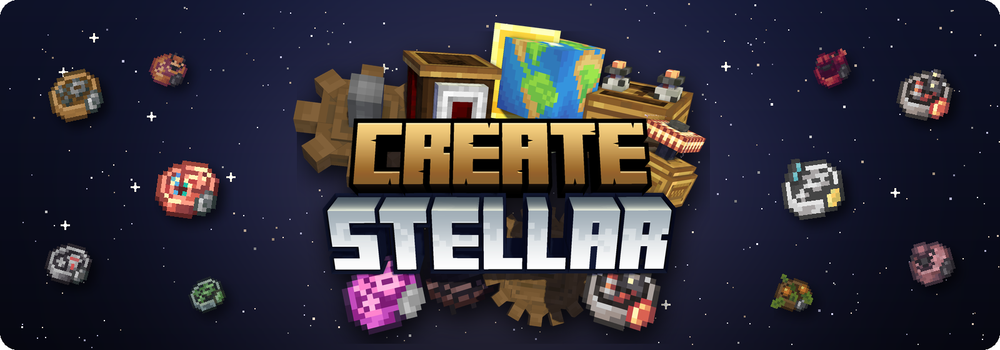
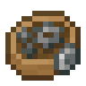
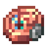
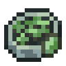
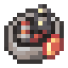
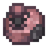
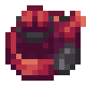
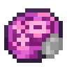

<p align="center">
  
</p>

<p align="center">
  <a href="https://www.curseforge.com/minecraft/modpacks/create-stellar"></a>
  <a href="https://discord.gg/stellar-834791723305009162"></a>
  
  
</p>

<p align="center">
  <b>A Create modpack about automating everything, one mechanism at a time, all the way to space.</b>
</p>

---

Create: Stellar is built around one progression line of twelve mechanisms. Each
mechanism is a chain of recipes, and the quest book asks you to automate every
link of that chain before you move on: the planks, the sheets, the molten
metal, then the mechanism itself. By the end you are refining oil, building
rockets and flying your own airships, all running on production lines you
designed.

## What's inside

- **The mechanism ladder.** Twelve mechanisms across five tiers, each tier
  with a main mechanism and its side branches.
- **A quest book that tracks your factory.** About 400 quests in 20 chapters,
  written for [Tenet](https://ellipog.dev/). Anything you have already
  automated is marked, so you never build the same line twice. From the
  Mystical tier on, the hand-holding stops and the recipe viewer is your guide.
- **Space.** Ad Astra rockets and planets, with the desh, ostrum and calorite
  mechanisms tying them into the factory.
- **Airships.** Create Aeronautics gets its own three-chapter questline: Lift,
  Thrust and Flight.
- **Metallurgy.** Crush, wash and melt ores into molten metal, then cast it
  back into ingots.
- **Big Create.** Big Cannons, Crafts & Additions, Diesel Generators,
  Enchantment Industry, Alloyed, Copycats+, Deco, Slice & Dice and more.
- **A world worth leaving the base for.** Terralith, Oh The Biomes We've Gone,
  Biomes O' Plenty, Alex's Caves, Alex's Mobs, When Dungeons Arise, Integrated
  Dungeons and Structures, and YUNG's structures.
- **Food and storage.** Farmer's Delight and its addons, Refined Storage,
  Sophisticated Storage and Backpacks, and Storage Drawers.
- **Ready to look good.** Sodium, Iris and Complementary Reimagined are
  included.

## The progression line

| Tier | Main line | Branches |
|:---:|:---|:---|
| 1 |  Basic |  Copper &nbsp;  Steel |
| 2 |  Precision |  Enchanted &nbsp;  Desh |
| 3 |  Conductive |  Refined &nbsp;  Ostrum |
| 4 |  Mystical |  Calorite |
| 5 |  Creative | |

## Playing

**CurseForge app:** open the
[CurseForge page](https://www.curseforge.com/minecraft/modpacks/create-stellar)
and click Install, or search for Create: Stellar in the app.

**Other launchers:** download the modpack zip from the Files tab on CurseForge
and import it. Prism Launcher imports CurseForge zips directly.

The pack needs Java 21, which the CurseForge app installs for you. Give the
game at least 6 GB of RAM; 8 GB is more comfortable with shaders on.

### Servers

Each release has a server pack under Additional Files on CurseForge, with a
README that covers setup and updating. The server and every player need the
same pack version.

## Reporting bugs

Open an [issue](https://github.com/ellipog/create-stellar/issues) with the pack
version, what happened and what you expected. Attach `logs/latest.log`, or the
crash report if the game crashed. For anything else, the
[Discord](https://discord.gg/stellar-834791723305009162) is the quickest way to
reach me.

## How this repository works

This is the pack's source in [packwiz](https://packwiz.infra.link/) format. It
holds metadata, not jars: every mod is a small `.pw.toml` file that points at
its file on CurseForge.

```
config/          default configs shipped with the pack
  tenet/quests/  the quest book
mods/            one .pw.toml per mod
shaderpacks/     Complementary Reimagined
pack.toml        pack name and version, Minecraft and NeoForge versions
index.toml       hashes of every file in the pack
```

Recipes, items, fluids, cobblestone generators and tags are not in this repo.
They live in the
[Create Stellar Companion](https://www.curseforge.com/minecraft/mc-mods/create-stellar-companion)
mod, so a recipe change ships as a companion release followed by a pack
release.

To build the CurseForge zip yourself, install packwiz and run:

```sh
packwiz refresh
packwiz curseforge export
```

### Contributing

Pull requests are welcome. Include every change your edit needs (the mod's
`.pw.toml`, its configs and a refreshed `index.toml`) so the pack still builds
from the branch as it is. To add a mod, use
`packwiz curseforge add <project url>`. If you're unsure whether a change fits
the pack, ask on Discord first.

## License

The configs, quests and metadata in this repository are licensed under
[GPL-3.0](LICENSE). The mods belong to their authors and are downloaded from
CurseForge; none of them are redistributed here.
